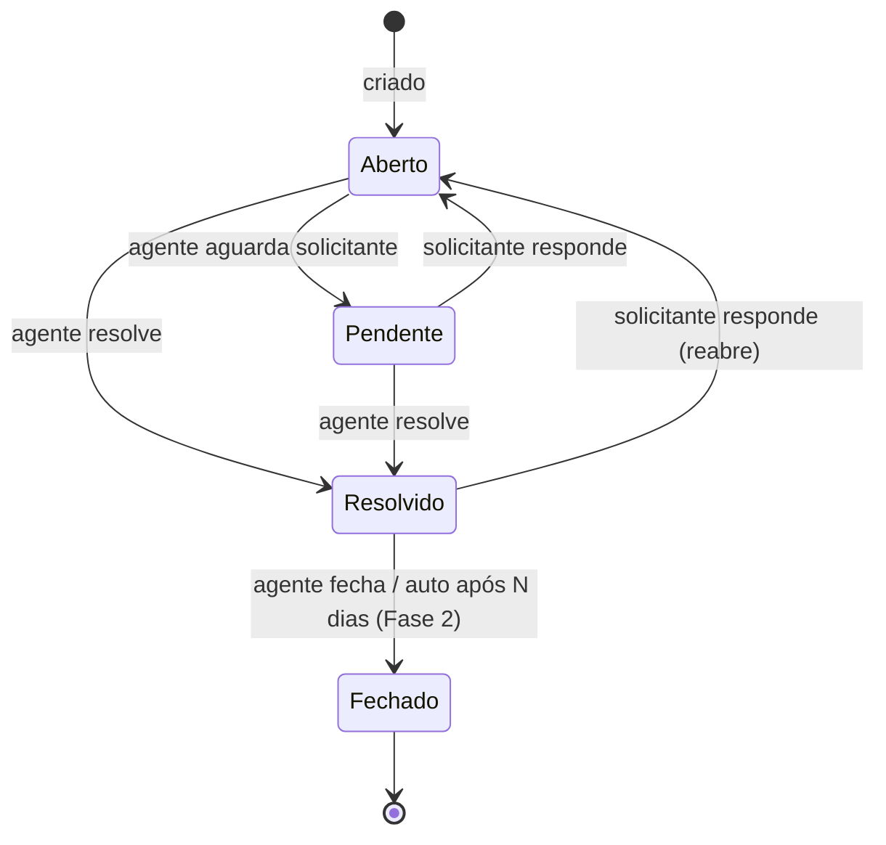

# 1. Escopo funcional

Critério de corte: entra no MVP o que é **indispensável para a virada da caixa `suporte@` (meta: terça 27/10), sem que os 20 agentes precisem voltar ao Freshdesk para tickets novos**. O que pode ser feito manualmente por algumas semanas fica para a Fase 2.

Legenda de complexidade, considerando 1 dev com Claude Code: **P** = até meio dia · **M** = cerca de 1 dia · **G** = mais de 2 dias.

## Matriz de escopo

| Módulo                   | Funcionalidade                                                          | Classif.         | Compl. | Dependências                  | Justificativa                                                                                                        |
| ------------------------ | ----------------------------------------------------------------------- | ---------------- | ------ | ----------------------------- | -------------------------------------------------------------------------------------------------------------------- |
| **Identidade**           | Login via Zitadel (OIDC + PKCE)                                         | **MVP**          | M      | Zitadel no ar                 | Pré-requisito de tudo                                                                                                |
|                          | Provisionamento JIT do usuário                                          | **MVP**          | P      | Login                         | Evita sincronização ativa                                                                                            |
|                          | Roles admin/supervisor/agente                                           | **MVP**          | P      | Zitadel                       | Controle de acesso básico                                                                                            |
|                          | Federação com o Google Workspace (IdP no Zitadel)                       | **MVP**          | P      | Projeto OAuth no Google Cloud | Resolve criação de contas, senha e 2ª etapa de uma vez. Sem ela, 20+ agentes teriam de ser cadastrados à mão         |
|                          | Webhook de desativação (Actions v2)                                     | Fase 2           | M      | Zitadel                       | No MVP, o token expira em até 1 h                                                                                    |
| **Tickets**              | Criar ticket (solicitante, pelo portal)                                 | **MVP**          | P      | Login                         | Núcleo                                                                                                               |
|                          | Criar ticket em nome de alguém (agente)                                 | **MVP**          | P      | —                             | Substitui ligações e conversas de corredor                                                                           |
|                          | Status (Aberto, Pendente, Resolvido, Fechado)                           | **MVP**          | P      | —                             | Mesmo vocabulário do Freshdesk, reduz o treinamento                                                                  |
|                          | Prioridade (Baixa, Média, Alta, Urgente)                                | **MVP**          | P      | —                             |                                                                                                                      |
|                          | Categoria                                                               | **MVP**          | P      | Cadastro                      | Substitui o "tipo" do Freshdesk                                                                                      |
|                          | Resposta pública e nota interna                                         | **MVP**          | M      | —                             | Núcleo do atendimento                                                                                                |
|                          | Anexos                                                                  | **MVP**          | M      | Object Storage                | Chegam por e-mail de qualquer forma. O upload pelo portal é o corte de contingência, não o armazenamento             |
|                          | Histórico de eventos (auditoria)                                        | **MVP**          | P      | —                             | Também atende à LGPD                                                                                                 |
|                          | Reabrir ao receber resposta do solicitante                              | **MVP**          | P      | —                             | Comportamento esperado pelos usuários                                                                                |
|                          | Locking otimista (evitar sobrescrita)                                   | **MVP**          | P      | —                             | Substitui a detecção de colisão no MVP                                                                               |
|                          | Busca por número e assunto                                              | **MVP**          | P      | —                             |                                                                                                                      |
|                          | Busca full-text (PostgreSQL FTS)                                        | Fase 2           | P      | —                             |                                                                                                                      |
|                          | Campos customizados                                                     | Fase 2           | M      | —                             | Coluna `custom_fields jsonb` já prevista                                                                             |
|                          | Merge de tickets                                                        | Fase 2           | M      | —                             | Baixa frequência com 500 tickets/mês                                                                                 |
|                          | Detecção de colisão em tempo real                                       | Fase 2           | M      | WebSocket                     | O locking otimista cobre o risco                                                                                     |
|                          | Tickets pai/filho, split                                                | Fora             | G      | —                             | Pouco uso interno                                                                                                    |
|                          | Time tracking                                                           | Fora             | M      | —                             | Avaliar a demanda depois                                                                                             |
| **Canais**               | Portal web interno                                                      | **MVP**          | —      | —                             | Canal secundário: consulta e abertura por quem preferir                                                              |
|                          | Notificação por e-mail (saída), com threading                           | **MVP**          | M      | SMTP Gmail                    | É por onde o solicitante recebe as respostas. Assunto com `[#1234]` e cabeçalhos `In-Reply-To`/`References`          |
|                          | **Abertura por e-mail** (`suporte@` → ticket)                           | **MVP**          | G      | IMAP Gmail                    | **É o canal principal hoje.** Sem isso o sistema não substitui o Freshdesk                                           |
|                          | Resposta por e-mail cai no mesmo ticket                                 | **MVP**          | M      | Abertura por e-mail           | Threading por `Message-ID`, fallback pela tag no assunto                                                             |
|                          | Agente responde pelo próprio e-mail (reconhecido como resposta pública) | **MVP**          | P      | Abertura por e-mail           | Regra barata dentro do mesmo parser. Sem suporte a notas internas por e-mail                                         |
|                          | Anti-loop (auto-respostas, férias) e idempotência por `Message-ID`      | **MVP**          | P      | Abertura por e-mail           | Inegociável: um loop pode gerar centenas de tickets                                                                  |
|                          | Chat, telefone, WhatsApp, redes sociais                                 | Fora             | G      | —                             | Fora do escopo de redução de licença                                                                                 |
| **Atribuição**           | Grupos de agentes                                                       | **MVP**          | P      | —                             | Filas por grupo                                                                                                      |
|                          | Atribuição manual (assumir ticket)                                      | **MVP**          | P      | —                             |                                                                                                                      |
|                          | Round-robin por grupo                                                   | Fase 2           | P      | —                             | Corte de contingência. Supervisor distribui manualmente                                                              |
|                          | Por skill ou carga                                                      | Fora             | G      | —                             | Desnecessário para 20 agentes                                                                                        |
| **SLA**                  | Políticas por prioridade                                                | Fase 2           | M      | —                             | Timestamps já são gravados no MVP                                                                                    |
|                          | Horário comercial e feriados                                            | Fase 2           | M      | SLA                           |                                                                                                                      |
|                          | Escalonamento                                                           | Fase 2           | M      | SLA                           |                                                                                                                      |
| **Automações**           | Respostas prontas (canned responses)                                    | Fase 2           | P      | —                             | Primeiro item da Fase 2: ganho rápido                                                                                |
|                          | Fechar automaticamente resolvidos após N dias                           | Fase 2           | P      | Scheduler                     |                                                                                                                      |
|                          | Regras na criação, por evento e por tempo                               | Fase 2           | G      | —                             | Motor de regras genérico é caro. Começar com regras fixas em código                                                  |
| **Solicitantes**         | Cadastro via Zitadel (JIT)                                              | **MVP**          | P      | Login                         |                                                                                                                      |
|                          | Empresa (escola/obra) e departamento do solicitante                     | **MVP**          | P      | Cadastros                     | Preenchidos numa tela de 1º acesso (obrigatória antes de abrir ticket) ou pelo admin                                 |
|                          | Filtro por empresa nas filas                                            | **MVP**          | P      | Empresa                       | Os agentes atendem várias escolas                                                                                    |
|                          | Terceiros (externos): só por e-mail, sem login, marcados no cadastro    | **MVP**          | P      | Abertura por e-mail           | Criados automaticamente quando o remetente é de domínio externo. O agente pode ajustar a marcação                    |
|                          | Triagem de "sem unidade" (tickets criados por e-mail)                   | **MVP**          | P      | Empresa                       | Indicador na fila. Resolver exige unidade definida                                                                   |
|                          | Histórico de tickets do solicitante                                     | **MVP**          | P      | —                             | Filtro na listagem                                                                                                   |
| **Base de conhecimento** | Artigos internos e FAQ                                                  | Fase 2           | M      | —                             |                                                                                                                      |
|                          | Sugestão de artigos ao abrir ticket                                     | Fora             | M      | Base de conhecimento          |                                                                                                                      |
| **CSAT**                 | Pesquisa de satisfação                                                  | Fase 2           | P      | E-mail                        |                                                                                                                      |
| **Relatórios**           | Contadores na fila (abertos, sem atribuição)                            | **MVP**          | P      | —                             | Visão operacional mínima                                                                                             |
|                          | Volume e tempos por agente e grupo                                      | Fase 2           | M      | Timestamps                    | Os dados já existem desde o dia 1                                                                                    |
| **Administração**        | Cadastro de grupos, categorias, empresas e departamentos                | **MVP via seed** | P      | —                             | Os dados entram por `prisma/seed.ts`. As telas de CRUD ficam para a 1ª semana da Fase 2, para abrir espaço ao e-mail |
|                          | Gestão de membros dos grupos e edição de usuário (unidade, terceiro)    | **MVP**          | P      | —                             | Tela mínima de admin, porque muda com frequência                                                                     |
|                          | Trilha de auditoria consultável                                         | Fase 2           | P      | —                             | Os dados já existem desde o dia 1                                                                                    |
| **Migração**             | Importar histórico do Freshdesk                                         | Fora (por ora)   | G      | Export                        | Decidido: não migrar agora. Mesmo assim, **exportar os dados ANTES de cancelar** (~08/11)                            |

### Resumo do MVP

1. Um e-mail para `suporte@missaosalesiana.org.br` vira ticket. O remetente recebe a confirmação com o número `[#1234]`. Quem responde ao e-mail cai no mesmo ticket. Remetente de domínio externo vira **terceiro**.
2. Login com a conta Google `@missaosalesiana.org.br`, via Zitadel. O usuário é criado no primeiro acesso e informa empresa e departamento.
3. O solicitante também pode abrir um ticket pelo portal (assunto, descrição, categoria, empresa e anexos), acompanhar e responder.
4. O agente vê as filas ("meus", "do meu grupo", "sem atribuição" e "todos"), filtra por empresa, faz a triagem dos "sem unidade", assume, responde, cria nota interna e muda status, prioridade, grupo e responsável.
5. Notificações por e-mail, no mesmo thread, para:
   - o solicitante, na criação (confirmação), em resposta pública e na resolução;
   - o grupo, quando um ticket é criado;
   - o responsável (ou o grupo), quando o solicitante responde.
6. Admin gerencia membros dos grupos e edita usuários (unidade, departamento, terceiro). Grupos, categorias, empresas e departamentos entram por seed.
7. Todos os eventos ficam registrados.

## Regras do canal de e-mail

| Situação                                                                               | Comportamento                                                                                                                                                                                     |
| -------------------------------------------------------------------------------------- | ------------------------------------------------------------------------------------------------------------------------------------------------------------------------------------------------- |
| E-mail novo (sem referência a ticket)                                                  | Cria ticket com `source = email`, assunto = assunto do e-mail, descrição = corpo sanitizado, anexos salvos. Envia confirmação `[#1234]` ao remetente e aviso ao grupo padrão da categoria "Geral" |
| Resposta com `In-Reply-To`/`References` conhecido, ou `[#1234]` no assunto             | Adiciona mensagem pública ao ticket. Só o texto novo é exibido; o trecho citado fica guardado. Pendente → Aberto; Resolvido → Aberto                                                              |
| Resposta a ticket **Fechado**                                                          | Cria um ticket novo com referência ao anterior (mesmo comportamento do Freshdesk)                                                                                                                 |
| Remetente desconhecido com domínio institucional                                       | Cria usuário sem login (vinculado no 1º acesso ao portal). Unidade fica vazia até a triagem                                                                                                       |
| Remetente desconhecido com domínio externo                                             | Cria usuário marcado como **terceiro**. Nunca terá login                                                                                                                                          |
| Remetente é agente e o e-mail referencia um ticket                                     | Registra como **resposta pública do agente**                                                                                                                                                      |
| `Auto-Submitted`, `Precedence: bulk/auto_reply`, `X-Autoreply`, remetente = `suporte@` | Ignora e registra como "descartado", para auditoria                                                                                                                                               |
| Mesmo `Message-ID` recebido duas vezes                                                 | Ignora (idempotência)                                                                                                                                                                             |
| Mais de 20 e-mails do mesmo remetente em 1 h                                           | Ignora os excedentes e alerta no log (proteção contra loop)                                                                                                                                       |
| Falha ao processar                                                                     | Marca o e-mail com o rótulo `helpdesk/erro` no Gmail, registra o erro e segue. Nunca apaga o e-mail                                                                                               |

Vocabulário na UI: "Unidade" em vez de "Empresa", porque é assim que os colaboradores falam. No código, `company`.

## Ciclo de vida do ticket

Regra: um ticket **Fechado** não reabre. Uma nova resposta do solicitante gera um novo ticket com referência ao anterior. Esse é o mesmo comportamento padrão do Freshdesk.

## Matriz de permissões

| Ação                                                            |          Solicitante          |      Agente      | Supervisor | Admin |
| --------------------------------------------------------------- | :---------------------------: | :--------------: | :--------: | :---: |
| Abrir ticket para si                                            |              ✅               |        ✅        |     ✅     |  ✅   |
| Ver os próprios tickets                                         |              ✅               |        ✅        |     ✅     |  ✅   |
| Ver tickets dos seus grupos                                     |               —               |        ✅        |     ✅     |  ✅   |
| Ver todos os tickets                                            |               —               |        —         |     ✅     |  ✅   |
| Ver notas internas                                              |               —               |        ✅        |     ✅     |  ✅   |
| Abrir ticket em nome de outro                                   |               —               |        ✅        |     ✅     |  ✅   |
| Responder, mudar status e prioridade                            |         só responder          | ✅ (seus grupos) |     ✅     |  ✅   |
| Atribuir a outro agente ou grupo                                |               —               | ✅ (seus grupos) |     ✅     |  ✅   |
| Cadastrar grupos, categorias, empresas, departamentos e membros |               —               |        —         |     —      |  ✅   |
| Definir roles                                                   | no Zitadel (admin do Zitadel) |                  |            |       |

Um agente que abre um ticket para si mesmo é tratado como solicitante **naquele ticket**.

Terceiros não têm login: interagem só por e-mail e são solicitantes dos próprios tickets. Como nunca acessam o portal, a linha "solicitante" se aplica a eles apenas pelo canal de e-mail.
