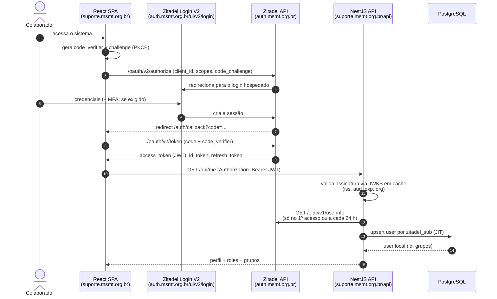

# 2. Integração com o Zitadel

> Versão de referência: **Zitadel v4.19.5** (15/10/2026). Helm chart **v9**, que já referencia o Zitadel v4 e inclui o deployment do **Login V2**.
> Legenda: 📘 = documentado pelo Zitadel · 💡 = recomendação deste discovery · ⚠️ = confirmar na instância

## 2.1 Estrutura no Zitadel

```
Instance (auth.msmt.org.br)
└── Organization: "Missão Salesiana de Mato Grosso"
    ├── Identity Provider: Google (Workspace missaosalesiana.org.br), com auto-criação e auto-vínculo por e-mail
    ├── Login policy: "Entrar com Google" (senha local só para break-glass)
    ├── Users: colaboradores criados automaticamente no 1º login + service user (Fase 2)
    └── Project: "Help Desk"
        ├── Roles: admin | supervisor | agente
        ├── Settings: "Assert roles on authentication" = ON
        └── Application: "helpdesk-web" (User Agent / SPA, PKCE, Auth Token Type = JWT)
```

💡 **Uma única aplicação basta.** A SPA obtém o token, e a API NestJS só **valida** esse token localmente via JWKS. Não é preciso registrar uma aplicação "API" no Zitadel, porque ela só seria necessária para _introspection_, que descartamos (ADR-003).

💡 **Não existe role "solicitante".** Qualquer usuário autenticado é solicitante. Isso evita conceder grant a centenas de pessoas. As roles só são atribuídas aos cerca de 20 agentes.

> ⚠️ **Desatualizado pelo ADR-011 (25/10/2026) e pela T22** (`docs/specs/T22-onboarding-liberacao.md`): a tela de consentimento do Google deixou de ser "Internal" (restrita à org) e passou a "Externo" — qualquer conta Google autentica. Terceiros também podem logar agora (RN-09): não são mais só registros sem `zitadel_sub` criados por e-mail, podem vincular o próprio login normalmente. O controle de quem **usa** o portal passou a ser a fila de liberação assistida (T22), não mais "quem está na organização do Zitadel".
>
> ~~💡 **Terceiros não entram no Zitadel.** Eles só interagem por e-mail, então existem apenas na base do help desk (`is_external = true`, `zitadel_sub = null`). Isso evita convidar externos para a organização e mantém o app "Internal" do Google como único caminho de login.~~

⚠️ Se a instância do Zitadel também atender usuários de fora da organização (outros apps ou outras orgs), a API deve rejeitar quem não pertence à org. A verificação usa o claim `urn:zitadel:iam:user:resourceowner:id`, solicitado com o escopo `urn:zitadel:iam:user:resourceowner`.

### Configurações obrigatórias da aplicação SPA

| Configuração        | Valor                                                                                     | Por quê                                                                            |
| ------------------- | ----------------------------------------------------------------------------------------- | ---------------------------------------------------------------------------------- |
| Tipo                | User Agent / PKCE                                                                         | 📘 Cliente público, sem secret no browser                                          |
| **Auth Token Type** | **JWT**                                                                                   | 📘 O padrão é token opaco (Bearer). Sem JWT, a API não consegue validar localmente |
| Redirect URIs       | `https://suporte.msmt.org.br/auth/callback` e `http://localhost:5173/auth/callback` (dev) |                                                                                    |
| Post-logout URIs    | `https://suporte.msmt.org.br/` e `http://localhost:5173/`                                 |                                                                                    |
| Dev mode            | ON apenas na instância de dev                                                             | Permite redirect em `http://`                                                      |

### Escopos solicitados pela SPA

```
openid profile email offline_access
urn:zitadel:iam:org:project:id:<PROJECT_ID>:aud
urn:zitadel:iam:org:projects:roles
urn:zitadel:iam:user:resourceowner
```

- 📘 `...:project:id:<PROJECT_ID>:aud` coloca o ID do projeto no `aud` do access token. A API valida contra ele.
- 📘 `...:projects:roles` gera o claim `urn:zitadel:iam:org:project:<PROJECT_ID>:roles`.
- ⚠️ Formato esperado do claim de roles: `{ "agente": { "<orgId>": "<orgDomain>" } }`. A API deve ler **as chaves** do objeto. Confirme com um token real (jwt.io ou `jose` decode) no dia 2.
- `offline_access` ativa o refresh token, para renovar o token sem refazer o login.

## 2.2 Autenticação

### Fluxo



### Frontend (React)

- 💡 Use as bibliotecas **`oidc-client-ts`** e **`react-oidc-context`**. Ambas são genéricas, maduras e muito presentes nos dados de treino do Claude, o que ajuda no desenvolvimento assistido.
- Guarde os tokens **em memória** (padrão `InMemoryWebStorage`), não no `localStorage`, para reduzir o impacto de XSS. O refresh é silencioso via refresh token.
- O logout chama `signoutRedirect()`, que acessa o `end_session_endpoint` do Zitadel.

### Backend (NestJS)

- 💡 **Guard global** (`APP_GUARD`) usando a biblioteca **`jose`** (`createRemoteJWKSet` + `jwtVerify`). Não é preciso Passport. São cerca de 60 linhas, fáceis de testar.
  - JWKS: `https://auth.msmt.org.br/oauth/v2/keys`. O `jose` já faz cache e refetch quando aparece um `kid` desconhecido, o que cobre a rotação de chaves.
  - Validar `iss` = `https://auth.msmt.org.br`, `aud` contendo `<PROJECT_ID>` e `exp`. Opcionalmente, validar o `resourceowner` contra o org ID.
- Decorators: `@Public()` (health check) e `@Roles('agente', 'supervisor')`.
- `CurrentUser`: objeto montado pelo guard com `sub`, `email`, `roles` e o `userId` local, já resolvido pelo JIT.
- 💡 Nos testes, gere um par de chaves RSA local, assine tokens de teste e injete um JWKS fake. Assim os testes não dependem do Zitadel.

### Login hospedado x customizado

💡 **Login hospedado (Login V2 do Zitadel).** Ele já traz MFA, passkeys, reset de senha, lockout e políticas, sem custo de desenvolvimento. A identidade visual (logo e cores) é configurável no Zitadel em _Branding_. Um login customizado via Session API custaria de 2 a 3 dias e assumiria responsabilidade de segurança.

📘 **Atenção (v4.19.2 e posteriores):** o Login V2 assina o cookie de sessão. É **obrigatório** configurar `ZITADEL_SESSION_COOKIE_SECRET` com 32 ou mais caracteres aleatórios, idêntico em todas as réplicas. Não use valores de exemplo, porque a v4.19.2 corrigiu um takeover de conta via cookie não assinado.

### Federação com o Google Workspace (MVP)

Os colaboradores já usam o Google Workspace em `missaosalesiana.org.br`, então o Google é o _Identity Provider_ da Organization. Isso resolve três problemas de uma vez: **criação de contas** (ninguém é cadastrado à mão), **senha** (fica no Google) e **desligamento** (a conta suspensa no Workspace não entra mais).

Passos (dia 2, cerca de 1 h, nenhum código):

1. **Google Cloud Console**, com a conta admin do Workspace: criar um projeto, configurar a _OAuth consent screen_ como **Internal** (📘 restringe o login a contas do próprio Workspace, o que dispensa validar domínio no Zitadel e não passa pela verificação de app do Google) e criar uma credencial _OAuth client ID_ do tipo _Web application_.
2. **Redirect URI** do client Google: a que o console do Zitadel exibir ao criar o IdP. ⚠️ Com o Login V2 a documentação indica `https://auth.msmt.org.br/idps/callback`; com o login clássico é `https://auth.msmt.org.br/ui/login/login/externalidp/callback`. Copie a URL do console do Zitadel, não a de memória.
3. **Zitadel → Organization → Settings → Identity Providers → Google:** informar client ID e secret, ativar **Automatic creation**, **Automatic update** e **Account linking** por e-mail, e ativar o IdP na _Login policy_ da org.
4. **Login policy da org:** manter _username/password_ ligado só até o Google funcionar. Depois, 💡 desligar, para que o único caminho seja o Google. Manter o admin da instância (org padrão) com senha e MFA como _break-glass_.
5. Testar com a sua conta, confirmar que o usuário apareceu na org e conceder a role `admin` no projeto.

**Consequências para o resto do plano:**

- O MFA passa a ser o do Google. 💡 Exigir **verificação em 2 etapas** no Workspace para a unidade organizacional dos agentes.
- O Zitadel quase não envia e-mail (não há verificação nem reset de senha). O SMTP dele só serve a fluxos administrativos.
- O 1º login de cada pessoa cria o usuário no Zitadel (IdP) e, no 1º request à API, no help desk (JIT). Os dois passos são automáticos.
- Empresa e departamento **não vêm do Google** no MVP: o help desk pede numa tela de 1º acesso. Na Fase 2, dá para ler a unidade organizacional via Admin SDK do Workspace, se compensar.

### Sessão e tokens (configuração OIDC da instância)

| Parâmetro                | Padrão Zitadel | 💡 Recomendado | Motivo                                                          |
| ------------------------ | -------------- | -------------- | --------------------------------------------------------------- |
| Access token lifetime    | 12 h           | **1 h**        | Limita a 1 h a latência de revogação de roles e de desligamento |
| ID token lifetime        | 12 h           | 1 h            |                                                                 |
| Refresh token idle       | 30 dias        | 7 dias         | Uso diário; inatividade longa exige novo login                  |
| Refresh token expiration | 90 dias        | 30 dias        |                                                                 |

⚠️ Confirme os valores padrão no console da sua instância (_Settings → OIDC Token lifetimes_).

### MFA

Com a federação, a 2ª etapa é a do Google. 💡 No admin do Workspace, torne a **verificação em 2 etapas obrigatória** ao menos para a unidade organizacional de agentes, supervisores e admins, porque eles acessam dados de terceiros. Não configure MFA adicional no Zitadel: seria uma segunda etapa redundante no mesmo login.

## 2.3 Autorização

**Divisão de responsabilidades:**

| Onde          | O quê                                                                    |
| ------------- | ------------------------------------------------------------------------ |
| **Zitadel**   | _Quem é_ (identidade) e _papel global_ (admin, supervisor, agente)       |
| **Aplicação** | _Escopo_: grupos de cada agente, quais tickets cada um vê, setor/unidade |

Motivo: a associação entre grupo e agente muda com frequência e é regra de negócio do help desk. Mantê-la no Zitadel exigiria uma role por grupo, o que daria uma explosão de roles e acoplamento.

**Regras de visibilidade (aplicadas no repositório, nunca só na UI):**

```
solicitante -> tickets onde requester_id = eu
agente      -> tickets onde requester_id = eu OU group_id ∈ meus grupos OU assignee_id = eu
supervisor  -> todos
admin       -> todos + administração
```

💡 Use **RBAC simples + filtro por grupo** em código. Um motor de políticas (CASL, OPA etc.) é desnecessário para 4 papéis.

**Latência de mudança de role:** a role vem no token. Uma mudança feita no Zitadel só vale após o refresh, no máximo 1 h com a configuração acima. Isso é aceitável para uso interno. Se for urgente, o usuário faz logout e login.

## 2.4 Ciclo de vida dos usuários

| Tema                        | MVP                                                                                                                                                                                                                                                                         | Fase 2                                                                                                                                                                                                                                               |
| --------------------------- | --------------------------------------------------------------------------------------------------------------------------------------------------------------------------------------------------------------------------------------------------------------------------- | ---------------------------------------------------------------------------------------------------------------------------------------------------------------------------------------------------------------------------------------------------- |
| Criação                     | Zitadel: auto-criação pelo IdP Google. Help desk: **JIT** no 1º request autenticado, `upsert` por `zitadel_sub`, com nome e e-mail obtidos no endpoint `userinfo` (📘 o access token JWT não contém `email` nem `name`). Uma tela de 1º acesso pede empresa e departamento  | Importar empresa e departamento do diretório do Workspace                                                                                                                                                                                            |
| Atualização (nome, e-mail)  | Sobrescreve a cada login (JIT)                                                                                                                                                                                                                                              | —                                                                                                                                                                                                                                                    |
| Desligamento                | Suspender a conta no Workspace já impede novos logins (💡 desative também no Zitadel). O token vigente expira em até 1 h. O admin pode marcar `active=false` no help desk, e o guard recusa                                                                                 | 📘 **Actions v2**: Execution do tipo _Event_ com Target HTTP para `/api/webhooks/zitadel`. ⚠️ Confirme os nomes dos eventos (ex.: `user.deactivated`, `user.removed`, `user.grant.*`) e a validação de assinatura no guia _Verify Payload Integrity_ |
| Tickets de agente desligado | Filtro "atribuídos a agentes inativos" para o supervisor redistribuir                                                                                                                                                                                                       | Reatribuição automática para a fila do grupo                                                                                                                                                                                                         |
| Solicitante que nunca logou | O e-mail recebido cria o usuário local (`zitadel_sub = null`, unidade vazia até a triagem). No 1º login pelo Google, o JIT encontra o registro pelo e-mail e preenche o `zitadel_sub`                                                                                       | —                                                                                                                                                                                                                                                    |
| Terceiro (externo)          | Criado pelo canal de e-mail quando o domínio do remetente não é institucional (`INTERNAL_EMAIL_DOMAINS`). Fica `is_external = true`. Pode logar depois (T22, RN-09): entra na fila de liberação como qualquer pessoa, mantendo o cadastro. O admin pode corrigir a marcação | —                                                                                                                                                                                                                                                    |

**Fonte da verdade:**

| Atributo                                                                  | Fonte            |
| ------------------------------------------------------------------------- | ---------------- |
| Senha, 2ª etapa, status da conta                                          | Google Workspace |
| sub, nome, e-mail (espelhados do Google)                                  | Zitadel          |
| Role (admin, supervisor, agente)                                          | Zitadel          |
| Grupos de atendimento, empresa, departamento, preferências de notificação | Help desk        |

## 2.5 Máquina a máquina

- **MVP:** não é necessário. A API não chama o Zitadel, só valida tokens.
- **Fase 2:** para listar usuários do Zitadel (ex.: autocomplete de solicitantes que nunca logaram), use um **service user** com **JWT Profile** (chave privada em Secret do Kubernetes) e permissão mínima de leitura de usuários na org. Evite PAT (Personal Access Token), que é de longa duração e mais difícil de rotacionar.

## 2.6 Operação e segurança

| Tema                 | Recomendação                                                                                                                                                                                                   |
| -------------------- | -------------------------------------------------------------------------------------------------------------------------------------------------------------------------------------------------------------- |
| Zitadel indisponível | Quem já está logado continua trabalhando até o token expirar, porque o JWKS fica em cache no `jose`. Novos logins falham. 💡 Rode o Zitadel com 2 réplicas e o login com 2 réplicas, com o mesmo cookie secret |
| Masterkey do Zitadel | 32 caracteres, em Secret, com **backup fora do cluster**. Sem ela, os dados criptografados do Zitadel ficam inacessíveis                                                                                       |
| Auditoria            | `ticket_events` registra o `actor_id` local, que referencia o `zitadel_sub`, e o Zitadel guarda os eventos de login. A correlação é feita pelo `sub`                                                           |
| Atualizações         | Fixe `image.tag` no Helm. Leia o release notes antes de cada upgrade. Na 4.x há mudanças de segurança relevantes em minors (ex.: 4.19.2 e 4.19.5)                                                              |
| SMTP do Zitadel      | A mesma conta Gmail do help desk (`suporte@missaosalesiana.org.br`, senha de app). Com o Google como IdP, o Zitadel quase não envia e-mail                                                                     |

### Ameaças principais (STRIDE resumido)

| Ameaça                     | Vetor                                               | Mitigação                                                                                         |
| -------------------------- | --------------------------------------------------- | ------------------------------------------------------------------------------------------------- |
| **S**poofing               | Token forjado ou de outro sistema                   | Assinatura via JWKS, `iss`, `aud` = project ID, `resourceowner`                                   |
| **T**ampering              | Alteração de ticket por quem não pode               | Autorização no repositório, locking otimista, `ticket_events` append-only                         |
| **R**epudiation            | "Não fui eu que respondi"                           | `ticket_events` com ator, timestamp e IP                                                          |
| **I**nformation disclosure | Solicitante vê ticket alheio (IDOR) ou nota interna | Toda query filtrada pelo escopo do usuário, testes de autorização obrigatórios, IDs UUID          |
| **I**nformation disclosure | XSS via HTML do corpo do ticket                     | Sanitização no backend (`sanitize-html`, allowlist) e CSP                                         |
| **D**enial of service      | Upload grande                                       | Limite de 20 MB por arquivo e 5 por mensagem, allowlist de MIME, rate limit (`@nestjs/throttler`) |
| **E**levation of privilege | Agente se dá role de admin                          | Roles só no Zitadel. Cuidado com a permissão `admin.impersonation` (v4.19.2+)                     |
