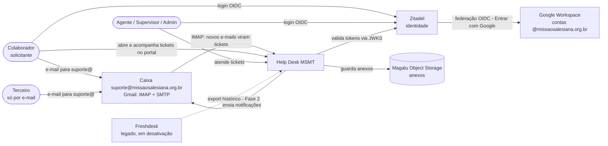
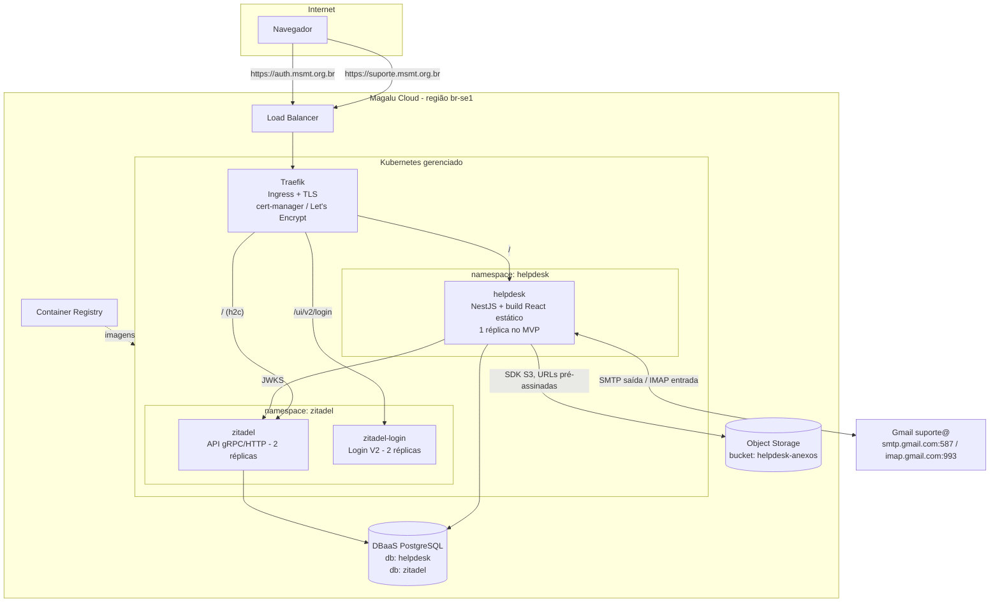
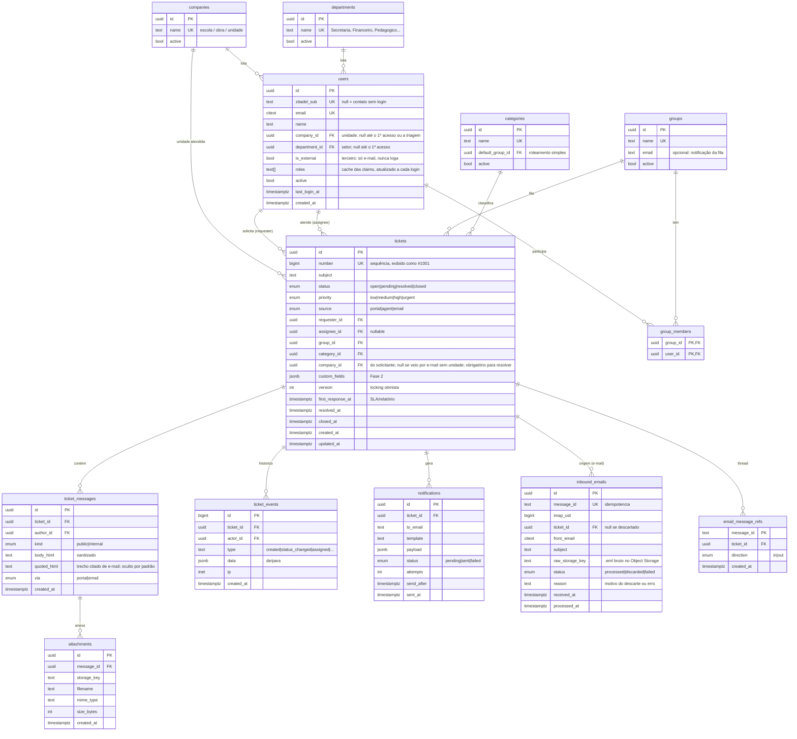

# 3. Arquitetura e infraestrutura

## 3.1 Visão de contexto (C4 nível 1)



## 3.2 Containers e deploy (C4 nível 2)



### Decisões de aplicação

| Tema              | Decisão                                                                                                                                                                                                                                                                                                                                                                                                                                                                                                                                                                                                    | Alternativa descartada                                                                                                                                                                                                                   |
| ----------------- | ---------------------------------------------------------------------------------------------------------------------------------------------------------------------------------------------------------------------------------------------------------------------------------------------------------------------------------------------------------------------------------------------------------------------------------------------------------------------------------------------------------------------------------------------------------------------------------------------------------- | ---------------------------------------------------------------------------------------------------------------------------------------------------------------------------------------------------------------------------------------- |
| Estilo            | **Monólito modular** NestJS                                                                                                                                                                                                                                                                                                                                                                                                                                                                                                                                                                                | Microsserviços: inviável para 1 dev                                                                                                                                                                                                      |
| Front             | **React + Vite + TypeScript**, servido pelo próprio NestJS (`@nestjs/serve-static`)                                                                                                                                                                                                                                                                                                                                                                                                                                                                                                                        | Container nginx separado: mais um deploy e CORS                                                                                                                                                                                          |
| UI kit            | **Mantine** (tabelas, formulários, datas, notificações, editor rico `@mantine/tiptap`)                                                                                                                                                                                                                                                                                                                                                                                                                                                                                                                     | shadcn/ui: exige montar mais componentes à mão                                                                                                                                                                                           |
| Dados no front    | **TanStack Query** (cache e polling) + React Router                                                                                                                                                                                                                                                                                                                                                                                                                                                                                                                                                        | Redux: desnecessário                                                                                                                                                                                                                     |
| Validação         | **Zod** com schemas compartilhados front/back em `packages/shared`                                                                                                                                                                                                                                                                                                                                                                                                                                                                                                                                         | class-validator: não compartilha com o front                                                                                                                                                                                             |
| ORM               | **Prisma** (ADR-006)                                                                                                                                                                                                                                                                                                                                                                                                                                                                                                                                                                                       | TypeORM: decorators e migrações menos previsíveis para a IA                                                                                                                                                                              |
| Jobs              | **`@nestjs/schedule`** (cron in-process). Com 1 réplica, sem lock; com mais réplicas, usar `pg_try_advisory_lock`                                                                                                                                                                                                                                                                                                                                                                                                                                                                                          | BullMQ/Redis: infraestrutura extra sem necessidade                                                                                                                                                                                       |
| E-mail de saída   | **Nodemailer** via `smtp.gmail.com:587` (STARTTLS), conta `suporte@missaosalesiana.org.br` com **senha de app** (exige verificação em 2 etapas na conta), + tabela **outbox** `notifications`, processada por cron a cada 1 min com retry. Cada envio leva `[#1234]` no assunto, `Message-ID` próprio (gravado em `email_message_refs`) e `In-Reply-To`/`References` do e-mail original. ⚠️ Limite do Workspace: cerca de 2.000 mensagens/dia por conta, folga de 10× para o volume previsto. Se precisar de mais, trocar por `smtp-relay.google.com` (configurado no admin do Workspace) sem mudar código | Envio síncrono: falha no SMTP quebraria o request                                                                                                                                                                                        |
| E-mail de entrada | **IMAP** (`imapflow`) na mesma caixa, polling de 1 min, `mailparser` para o parse, extração do texto novo com um _reply parser_, tabela **inbox** `inbound_emails` para idempotência. Detalhes em §3.3                                                                                                                                                                                                                                                                                                                                                                                                     | Gmail API + Pub/Sub: push em tempo real, mas exige delegação em todo o domínio, tópico Pub/Sub e endpoint público. Provedores de inbound (Mailgun, SendGrid, Postmark): exigem mudar o MX ou um encaminhamento e trazem outro fornecedor |
| Busca             | `ILIKE` em número e assunto (MVP) → **PostgreSQL FTS** com `unaccent` + `portuguese` (Fase 2)                                                                                                                                                                                                                                                                                                                                                                                                                                                                                                              | Elasticsearch/Meilisearch: excessivo para cerca de 6 mil tickets/ano                                                                                                                                                                     |
| Tempo real        | **Polling** de 30 s nas listas + **locking otimista** (`version`)                                                                                                                                                                                                                                                                                                                                                                                                                                                                                                                                          | WebSocket: Fase 2                                                                                                                                                                                                                        |
| Anexos            | Interface `StorageService` com driver **local** (dev) e **S3** (prod). Upload **multipart pela API** (até 20 MB) e download por stream pela API, ambos após a checagem de escopo. O mesmo serviço guarda os anexos vindos por e-mail e o `.eml` bruto                                                                                                                                                                                                                                                                                                                                                      | URLs pré-assinadas: exigem CORS no bucket e não atendem à entrada por e-mail. Anexo no banco: incha o PostgreSQL e os backups                                                                                                            |
| HTML rico         | Editor tiptap no front + **`sanitize-html`** no back, antes de gravar                                                                                                                                                                                                                                                                                                                                                                                                                                                                                                                                      | Markdown: menos familiar para usuários do Freshdesk                                                                                                                                                                                      |
| Logs              | `nestjs-pino`, JSON em stdout, **sem corpo de mensagem nem PII**                                                                                                                                                                                                                                                                                                                                                                                                                                                                                                                                           |                                                                                                                                                                                                                                          |
| Health            | `@nestjs/terminus` em `/api/health` (liveness/readiness)                                                                                                                                                                                                                                                                                                                                                                                                                                                                                                                                                   |                                                                                                                                                                                                                                          |

## 3.3 Processamento de e-mail

```mermaid
sequenceDiagram
    autonumber
    actor R as Remetente
    participant GM as Gmail (suporte@)
    participant IN as InboundEmailService<br/>(cron 1 min)
    participant DB as PostgreSQL
    participant S3 as Object Storage
    participant OUT as NotificationService<br/>(outbox, cron 1 min)

    R->>GM: e-mail para suporte@
    IN->>GM: IMAP: INBOX, UID > último processado (ignora a flag de lido)
    GM-->>IN: mensagem bruta (.eml)
    IN->>DB: Message-ID já visto? (inbound_emails)
    alt duplicado, auto-resposta ou remetente = suporte@
        IN->>DB: registra como "descartado" + motivo
        IN->>GM: rótulo helpdesk/descartado, arquiva
    else novo
        IN->>S3: guarda o .eml bruto
        IN->>IN: parse (mailparser), separa texto novo do citado, sanitiza HTML
        IN->>DB: resolve ticket: In-Reply-To/References → email_message_refs; senão [#n] no assunto; senão ticket novo
        IN->>DB: resolve remetente: users.email; senão cria (terceiro se domínio não institucional)
        IN->>DB: transação: ticket ou mensagem + anexos + ticket_events + notifications (outbox)
        IN->>GM: rótulo helpdesk/processado, arquiva
    end
    OUT->>GM: SMTP: confirmação ou resposta, com Message-ID próprio, In-Reply-To e [#n] no assunto
    OUT->>DB: grava o Message-ID em email_message_refs
```

| Tema                    | Decisão                                                                                                                                                                                                                                                                                                                                                                                                                                                      |
| ----------------------- | ------------------------------------------------------------------------------------------------------------------------------------------------------------------------------------------------------------------------------------------------------------------------------------------------------------------------------------------------------------------------------------------------------------------------------------------------------------ |
| Caixa                   | `suporte@missaosalesiana.org.br`, **caixa de usuário** do Gmail com verificação em 2 etapas e senha de app. Confirmado em 19/10 que é caixa de usuário, não Grupo do Google.                                                                                                                                                                                                                                                                                 |
| Leitura                 | `imapflow`, pasta `INBOX`, só mensagens com `UID` maior que o último processado (cursor `mailbox.last_uid` em `app_settings`), **sem depender da flag de lido**: o Freshdesk, que hoje lê a mesma caixa, pode marcar mensagens como lidas. Na primeira execução, o cursor começa na primeira mensagem com data interna ≥ `MAILBOX_START_SINCE` (data/hora da virada); sem essa variável, começa no UID atual. **E-mails antigos da caixa não viram tickets** |
| Após processar          | Aplicar o rótulo `helpdesk/processado` (ou `helpdesk/descartado`, `helpdesk/erro`) e **manter na INBOX** (decisão da T21: o rollback da virada continua simples, porque o Freshdesk reconectado enxerga tudo). **Nunca apagar.** A caixa continua sendo o arquivo de segurança                                                                                                                                                                               |
| Idempotência            | `inbound_emails.message_id` é único. Reprocessar nunca duplica ticket                                                                                                                                                                                                                                                                                                                                                                                        |
| Threading               | 1) `In-Reply-To` e cada item de `References` contra `email_message_refs`; 2) `[#1234]` no assunto; 3) ticket novo. Resposta a ticket Fechado gera ticket novo com `ticket_events.data.reopened_from`                                                                                                                                                                                                                                                         |
| Texto novo x citado     | Reply parser (`email-reply-parser` ou equivalente) separa a resposta do texto citado. O texto novo vai em `body_html`; o citado em `quoted_html` (oculto na UI, expansível). Se a separação falhar, tudo vai para `body_html`                                                                                                                                                                                                                                |
| Remetente               | `users.email` (citext). Desconhecido → cria usuário: `is_external = domínio ∉ INTERNAL_EMAIL_DOMAINS`. Agente conhecido respondendo a um ticket → mensagem pública de autoria dele                                                                                                                                                                                                                                                                           |
| Anti-loop               | Descartar se `Auto-Submitted ≠ no`, `Precedence: bulk/junk/auto_reply`, `X-Autoreply`, `X-Auto-Response-Suppress`, ou `From = suporte@`. Limite de 20 e-mails/h por remetente                                                                                                                                                                                                                                                                                |
| Saída                   | `From: Suporte MSMT <suporte@missaosalesiana.org.br>`, `Reply-To` idem, `Message-ID: <tk-{ticket}-{uuid}@suporte.msmt.org.br>`, `In-Reply-To` e `References` com o Message-ID do e-mail recebido quando houver, assunto `[#1234] {assunto}`. Corpo com a resposta, uma linha "responda este e-mail para continuar o atendimento" e o link do portal                                                                                                          |
| ⚠️ Gmail e `Message-ID` | O SMTP do Gmail preserva um `Message-ID` bem formado, mas isso precisa ser **confirmado no teste com `suporte-teste@`** (dia 4). Se o Gmail reescrever, o fallback `[#1234]` continua funcionando                                                                                                                                                                                                                                                            |
| Dev e testes            | Driver `MAILBOX_DRIVER=folder`: qualquer `.eml` em `./.inbox/` é processado como se viesse por IMAP. Os testes usam fixtures `.eml` e nunca tocam o Gmail. O Mailpit captura a saída                                                                                                                                                                                                                                                                         |
| Configuração            | `MAILBOX_DRIVER`, `MAILBOX_HOST`, `MAILBOX_USER`, `MAILBOX_PASSWORD`, `MAILBOX_START_SINCE`, `SMTP_*`, `MAIL_FROM`, `INTERNAL_EMAIL_DOMAINS=missaosalesiana.org.br`, `INBOUND_RATE_LIMIT_PER_HOUR=20`                                                                                                                                                                                                                                                        |

## 3.4 Infraestrutura na Magalu Cloud

> ⚠️ Produtos confirmados por anúncios e documentação pública da Magalu Cloud: Kubernetes gerenciado, Container Registry, DBaaS (PostgreSQL/MySQL) e Object Storage S3-compatível. As regiões disponíveis são `br-se1` (padrão), `br-ne1` e `br-mgl1`. **Valide limites, versões do PostgreSQL e preços no console antes do dia 1.**

| Componente       | Decisão                                                                                                    | Observação                                                                                                                                                                                                                                                                                                             |
| ---------------- | ---------------------------------------------------------------------------------------------------------- | ---------------------------------------------------------------------------------------------------------------------------------------------------------------------------------------------------------------------------------------------------------------------------------------------------------------------- |
| Cluster          | Kubernetes gerenciado, **2 nós pequenos**                                                                  | Cabe Zitadel (2+2 réplicas), app e Traefik                                                                                                                                                                                                                                                                             |
| Banco            | **DBaaS PostgreSQL**, instância única com dois bancos: `zitadel` e `helpdesk`, cada um com usuário próprio | Backup e failover pelo provedor. ⚠️ Confirmar se a versão oferecida é suportada pelo Zitadel v4                                                                                                                                                                                                                        |
| Ingress          | **Traefik** (Helm) + **cert-manager** (Let's Encrypt)                                                      | ⚠️ O projeto **ingress-nginx foi descontinuado** pela comunidade Kubernetes em 2026: não adote em projeto novo                                                                                                                                                                                                         |
| Zitadel          | **Helm chart oficial v9**, `image.tag` fixo em `v4.19.5`                                                   | Requer `ExternalDomain=auth.msmt.org.br`, `ExternalPort=443`, `ExternalSecure=true`, TLS terminado no Traefik e backend em **h2c** (gRPC). No Traefik: annotation `traefik.ingress.kubernetes.io/service.serversscheme: h2c` no Service do Zitadel. ⚠️ Conferir os values do chart para o roteamento de `/ui/v2/login` |
| Segredos         | Kubernetes Secrets: masterkey do Zitadel, `ZITADEL_SESSION_COOKIE_SECRET`, credenciais do banco, SMTP e S3 | Masterkey com backup em cofre fora do cluster                                                                                                                                                                                                                                                                          |
| Imagens          | Container Registry da Magalu Cloud                                                                         |                                                                                                                                                                                                                                                                                                                        |
| Manifests do app | **Kustomize** (`base` + `overlays/prod`)                                                                   | Mais simples que escrever um chart Helm próprio                                                                                                                                                                                                                                                                        |
| Deploy MVP       | Script `make deploy` (build, push e `kubectl apply -k`) rodado da máquina do dev                           | CI/CD automatizado na Fase 2 (depende de onde o repositório ficará hospedado)                                                                                                                                                                                                                                          |
| Backup           | Snapshots diários do DBaaS + CronJob semanal de `pg_dump` para o Object Storage                            | Teste de restore antes do go-live                                                                                                                                                                                                                                                                                      |
| Monitoramento    | Uptime externo (ex.: Uptime Kuma ou serviço gratuito) em `/api/health` e `auth.msmt.org.br/debug/healthz`  | Prometheus/Grafana na Fase 2                                                                                                                                                                                                                                                                                           |
| DNS              | `suporte.msmt.org.br` e `auth.msmt.org.br` (registros A para o IP do LB)                                   | Criar no mesmo lugar onde estão os registros MX do Google Workspace                                                                                                                                                                                                                                                    |

### Kubernetes no MVP: sim ou não?

💡 **Sim, com contingência.** O Kubernetes é o destino desejado, e o Zitadel tem chart oficial. O risco está no tempo de configuração (ingress h2c, TLS e DNS). Regra de decisão: **se o login pelo Zitadel no cluster não funcionar até o fim do dia 1**, mude para uma **VM Magalu com Docker Compose** (Zitadel + Login V2 + app + Caddy) e migre para o Kubernetes na Fase 2. O código não muda, só o deploy.

### Ambiente local (desenvolvimento)

`docker-compose.yml` com:

- `postgres` (bancos `helpdesk` e `zitadel`);
- `zitadel` + `zitadel-login` (use o compose de exemplo da documentação oficial, com a mesma versão de produção);
- `mailpit` (captura os e-mails enviados, com UI web);
- o storage usa o **driver local em disco** (ou um bucket de dev na Magalu). Não é preciso MinIO;
- a entrada de e-mail usa `MAILBOX_DRIVER=folder`: um `.eml` colocado em `./.inbox/` é processado como se tivesse chegado por IMAP. Para o teste real, `MAILBOX_DRIVER=imap` apontando para `suporte-teste@` com a senha de app.

A API e o front rodam fora do Docker (`pnpm dev`), com hot reload.

## 3.5 Modelo de dados inicial



Regras do modelo:

- `ticket_events` é **append-only**: nunca recebe UPDATE nem DELETE pela aplicação. Ele serve como histórico na tela e como trilha de auditoria (LGPD).
- `first_response_at` é preenchido na primeira mensagem `public` de um agente. `resolved_at` e `closed_at` acompanham as mudanças de status. Isso deixa a Fase 2 (SLA e relatórios) **retroativa**.
- `tickets.company_id` (unidade) vem do solicitante. Fica nulo quando o ticket chega por e-mail de alguém sem unidade cadastrada; a fila mostra "sem unidade" e **resolver exige unidade**. Ao definir a unidade do ticket, o sistema oferece gravar a mesma no usuário. O departamento fica só no usuário.
- `inbound_emails` e `email_message_refs` existem para idempotência e threading. `app_settings` (chave/valor) guarda o cursor `mailbox.last_uid`.
- Os índices iniciais são: `tickets(status, group_id)`, `tickets(assignee_id, status)`, `tickets(requester_id)`, `tickets(company_id, status)`, `ticket_messages(ticket_id, created_at)` e `notifications(status, send_after)`.
- Fase 2 adiciona: `sla_policies`, `business_hours`, `holidays`, `canned_responses`, `kb_articles`, `csat_responses`, `inbound_emails` (threading via `Message-ID`/`In-Reply-To`).

## 3.6 Estrutura do repositório

💡 **Monorepo pnpm** (workspaces). É um único repositório e um único `CLAUDE.md`, e os tipos e schemas são compartilhados entre front e back.

```
helpdesk/
├── CLAUDE.md
├── README.md
├── package.json                 # scripts raiz: dev, build, test, lint, typecheck
├── pnpm-workspace.yaml
├── docker-compose.yml           # postgres, zitadel, zitadel-login, mailpit
├── .env.example
├── Makefile                     # deploy, db:migrate, etc.
├── apps/
│   ├── api/                     # NestJS
│   │   ├── prisma/
│   │   │   ├── schema.prisma
│   │   │   ├── migrations/
│   │   │   └── seed.ts
│   │   ├── src/
│   │   │   ├── main.ts
│   │   │   ├── app.module.ts
│   │   │   ├── common/          # prisma.service, filtros, pipes zod, logger
│   │   │   ├── auth/            # guard JWT, decorators @Public/@Roles, CurrentUser, JIT
│   │   │   ├── users/
│   │   │   ├── groups/
│   │   │   ├── categories/
│   │   │   ├── companies/       # escolas / obras / unidades
│   │   │   ├── departments/
│   │   │   ├── tickets/         # controller, service, repository (com escopo), events
│   │   │   ├── attachments/     # StorageService (local | s3)
│   │   │   ├── notifications/   # outbox, templates, cron de envio, Message-ID
│   │   │   ├── inbound-email/   # MailboxSource (imap | folder), parser, threading, anti-loop, cron
│   │   │   └── health/
│   │   └── test/                # e2e (supertest, banco helpdesk_test do compose)
│   │       └── fixtures/        # .eml de exemplo: novo, resposta, auto-resposta, com anexo
│   └── web/                     # React + Vite
│       └── src/
│           ├── main.tsx
│           ├── auth/            # react-oidc-context, rota de callback, RequireRole, tela de 1º acesso
│           ├── api/             # client fetch + hooks TanStack Query
│           ├── features/
│           │   ├── tickets/     # lista, detalhe, novo, responder
│           │   └── admin/       # grupos, categorias, empresas, departamentos, membros
│           ├── components/
│           └── routes.tsx
├── packages/
│   └── shared/                  # schemas zod, enums, tipos de DTO
├── deploy/
│   ├── k8s/
│   │   ├── base/                # deployment, service, ingress, configmap
│   │   └── overlays/prod/
│   ├── zitadel/values.yaml      # values do Helm chart (sem segredos)
│   └── traefik/values.yaml
└── docs/
    └── discovery/               # este discovery
```

## 3.7 Contrato inicial da API (MVP)

| Método e rota                                                                                          | Papel       | Descrição                                                           |
| ------------------------------------------------------------------------------------------------------ | ----------- | ------------------------------------------------------------------- |
| `GET /api/me`                                                                                          | autenticado | Perfil, roles e grupos (dispara o JIT)                              |
| `PATCH /api/me`                                                                                        | autenticado | Atualiza empresa e departamento (tela de 1º acesso)                 |
| `GET /api/companies`, `GET /api/departments`                                                           | autenticado | Listas para os formulários                                          |
| `GET /api/tickets?view=mine\|group\|unassigned\|all&status=&companyId=&q=&page=`                       | autenticado | Lista filtrada pelo escopo do usuário                               |
| `POST /api/tickets`                                                                                    | autenticado | Cria (agente pode informar `requesterId`)                           |
| `GET /api/tickets/:id`                                                                                 | escopo      | Detalhe + mensagens (sem `internal` para solicitante) + eventos     |
| `PATCH /api/tickets/:id`                                                                               | agente+     | Status, prioridade, grupo, responsável, categoria (exige `version`) |
| `POST /api/tickets/:id/messages`                                                                       | escopo      | Resposta pública ou nota interna (`internal` só para agente+)       |
| `POST /api/tickets/:id/attachments` (multipart)                                                        | escopo      | Upload, até 20 MB por arquivo e 5 por mensagem                      |
| `GET /api/attachments/:id`                                                                             | escopo      | Download por stream                                                 |
| `GET /api/groups/:id/members`                                                                          | agente+     | Agentes do grupo, para atribuição                                   |
| `GET /api/users?q=`                                                                                    | admin       | Busca de usuários para administração                                |
| `PATCH /api/users/:id`                                                                                 | admin       | Edita unidade, departamento, marcação de terceiro e `active`        |
| `CRUD /api/groups`, `/api/categories`, `/api/companies`, `/api/departments`, `/api/groups/:id/members` | admin       | Administração                                                       |
| `GET /api/health`                                                                                      | público     | Health check                                                        |
