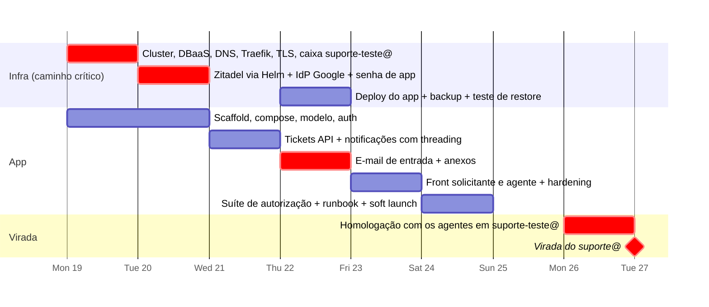

# 5. Plano do MVP, backlog, virada do e-mail e riscos

## 5.1 Duas datas

| Data          | Marco                | O que significa                                                                                                              |
| ------------- | -------------------- | ---------------------------------------------------------------------------------------------------------------------------- |
| **Sáb 24/10** | **Soft launch**      | Portal, login e canal de e-mail no ar, apontados para a caixa `suporte-teste@`. Os agentes exploram sem impacto nos usuários |
| **Ter 27/10** | **Virada do e-mail** | A caixa `suporte@` é desconectada do Freshdesk. A partir daí, todo ticket novo nasce no sistema novo                         |
| ~08/11        | Fim do Freshdesk     | Só conclui os tickets antigos. Exportar tudo antes de cancelar                                                               |

Se você preferir manter o 24/10 como data única, o custo é entrar no ar sem o canal de e-mail, que é o que todo mundo usa. Não recomendo. A convivência com o Freshdesk até ~08/11 torna o 27/10 seguro.

## 5.2 Plano dia a dia (1 dev + Claude Code)

Duas trilhas em paralelo: **infra** (você nos consoles e no cluster) e **app** (o Claude Code executa o backlog e você revisa e testa).

| Dia                | Infra                                                                                                                                                                                           | App (tarefas)                                  | Marco de saída (go/no-go)                                                                                                                                 |
| ------------------ | ----------------------------------------------------------------------------------------------------------------------------------------------------------------------------------------------- | ---------------------------------------------- | --------------------------------------------------------------------------------------------------------------------------------------------------------- |
| **Seg 19** (tarde) | Criar a caixa `suporte-teste@missaosalesiana.org.br` (usuário, 2 etapas, senha de app). Criar cluster, DBaaS (bancos `zitadel` e `helpdesk`), registry e bucket. DNS, Traefik, cert-manager     | T01, T02, T03                                  | `https://auth.msmt.org.br` responde com TLS válido. Monorepo roda local                                                                                   |
| **Ter 20**         | Zitadel via Helm (v4.19.5): org, projeto, roles, app SPA (JWT), branding. **IdP Google** (app OAuth "Internal" + IdP na org). **Se o login não funcionar até 14 h → contingência VM + compose** | T04, T05, T06, T07                             | "Entrar com Google" funciona contra o Zitadel de produção a partir do app local. Claim de roles confirmado                                                |
| **Qua 21**         | Senha de app de `suporte@` (produção). Anotar no admin do Freshdesk (Admin → Canais → E-mail) como a caixa está conectada e onde se desconecta                                                  | T08, T09, T10, T14                             | Agente atende um ticket de ponta a ponta localmente. E-mails de saída no Mailpit com `[#n]` e `In-Reply-To`                                               |
| **Qui 22**         | Deploy do app (T17). CronJob de backup. **Teste de restore**                                                                                                                                    | T21, T13                                       | Um e-mail para `suporte-teste@` vira ticket no ambiente de produção. A resposta ao e-mail cai no mesmo ticket. Gmail preserva o `Message-ID`? (confirmar) |
| **Sex 23**         | Uptime monitor. Verificação em 2 etapas obrigatória no Workspace para os agentes                                                                                                                | T11, T12, T16, T18                             | Fluxos de solicitante e de agente completos no ar. Roles concedidas aos 20 agentes (cada um faz 1 login antes)                                            |
| **Sáb 24**         | —                                                                                                                                                                                               | T19, T20, correções                            | **Soft launch.** Suíte de autorização verde. Agentes recebem o link e o e-mail de teste                                                                   |
| **Seg 26**         | Homologação: 2–3 agentes abrem e respondem tickets reais via `suporte-teste@` e portal                                                                                                          | Correções                                      | **Go/no-go da virada**                                                                                                                                    |
| **Ter 27** (manhã) | **Virada** (ver §5.4)                                                                                                                                                                           | —                                              | Primeiro ticket real nasce no sistema novo                                                                                                                |
| Qua 28 → 08/11     | Freshdesk só conclui tickets antigos                                                                                                                                                            | Fase 2: telas de admin, respostas prontas, SLA | Export completo do Freshdesk antes do cancelamento                                                                                                        |

### Cortes de contingência (em ordem)

Se algum marco atrasar, corte nesta ordem:

1. **Upload de anexo pelo portal** (anexos por e-mail continuam).
2. **Filtro por unidade** nas filas (a triagem "sem unidade" fica).
3. **Tela de admin de membros** → `prisma/seed.ts`.
4. **Resposta de agente pelo próprio e-mail** (agentes respondem só pelo portal).
5. **Kubernetes** → VM com Docker Compose (decisão às 14 h de terça).
6. **Data da virada** → quinta 29/10 ou segunda 02/11. Ainda cabe antes de 08/11.

**Não-negociáveis** (nunca cortar): autorização no backend com testes, sanitização de HTML, idempotência e anti-loop no e-mail, TLS, backup testado, virada reversível.

## 5.3 Backlog do MVP (tarefas para o Claude Code)

Cada tarefa cabe em **uma sessão** do Claude Code. Fluxo por tarefa: colar o ID e a descrição → pedir o plano → revisar → pedir a implementação → `pnpm test` e `pnpm typecheck` → commit.

| ID      | Tarefa                                                                                                                                                                                                                                                                                                                                                                                                                                                                                                         | Critério de aceite                                                                                                                                                                                                                                                                                                                                                                                                                                                                                                | Depende            |
| ------- | -------------------------------------------------------------------------------------------------------------------------------------------------------------------------------------------------------------------------------------------------------------------------------------------------------------------------------------------------------------------------------------------------------------------------------------------------------------------------------------------------------------- | ----------------------------------------------------------------------------------------------------------------------------------------------------------------------------------------------------------------------------------------------------------------------------------------------------------------------------------------------------------------------------------------------------------------------------------------------------------------------------------------------------------------- | ------------------ |
| **T01** | Scaffold do monorepo pnpm: `apps/api` (NestJS), `apps/web` (Vite React TS), `packages/shared`. Scripts raiz `dev`, `build`, `test`, `lint`, `typecheck`. oxlint + Prettier                                                                                                                                                                                                                                                                                                                                     | `pnpm build`, `pnpm test` e `pnpm typecheck` passam na raiz                                                                                                                                                                                                                                                                                                                                                                                                                                                       | —                  |
| **T02** | `docker-compose.yml` com postgres, zitadel + zitadel-login (v4.19.5) e mailpit. `.env.example` documentado, incluindo `MAILBOX_*`, `SMTP_*`, `INTERNAL_EMAIL_DOMAINS`                                                                                                                                                                                                                                                                                                                                          | `docker compose up` sobe tudo. Console do Zitadel em localhost. Mailpit em `:8025`                                                                                                                                                                                                                                                                                                                                                                                                                                | T01                |
| **T03** | Prisma: `schema.prisma` com todas as entidades (03-arquitetura §3.5, incluindo `is_external`, `quoted_html`, `inbound_emails`, `email_message_refs`, `app_settings`), migração inicial, `PrismaService`, seed: 2 grupos, categorias (com "Geral" como padrão), 2 unidades, 3 departamentos                                                                                                                                                                                                                     | `prisma migrate dev` aplica sem erro. O teste confirma o seed                                                                                                                                                                                                                                                                                                                                                                                                                                                     | T01                |
| **T04** | Auth na API: guard global com `jose` (JWKS remoto, `iss`, `aud`, `exp`), decorators `@Public` e `@Roles`, extração das roles do claim `urn:zitadel:iam:org:project:<id>:roles`                                                                                                                                                                                                                                                                                                                                 | Testes com JWKS fake: token válido → 200; expirado, aud errado ou assinatura inválida → 401; role ausente → 403                                                                                                                                                                                                                                                                                                                                                                                                   | T01                |
| **T05** | JIT: `GET /api/me` faz upsert por `zitadel_sub`, buscando nome e e-mail no endpoint `userinfo` do Zitadel (o access token não os traz); vincula por e-mail um usuário criado pelo canal de e-mail; atualiza o cache de roles; recusa `active=false`; retorna `needsOnboarding` quando falta unidade ou departamento                                                                                                                                                                                            | Testes: 1º acesso cria; 2º atualiza nome; usuário sem `zitadel_sub` com o mesmo e-mail é vinculado; inativo → 403; terceiro tentando logar → 403                                                                                                                                                                                                                                                                                                                                                                  | T03, T04           |
| **T06** | Auth no front: `react-oidc-context`, rota `/auth/callback`, `RequireAuth`, `RequireRole`, client de API com Bearer, logout                                                                                                                                                                                                                                                                                                                                                                                     | Rota protegida redireciona sem sessão. Login manual contra o Zitadel local funciona                                                                                                                                                                                                                                                                                                                                                                                                                               | T01, T02           |
| **T07** | Layout base com Mantine: shell (menu lateral, cabeçalho com usuário e logout), páginas vazias das rotas                                                                                                                                                                                                                                                                                                                                                                                                        | Navegação entre rotas. Menu de agente só com role                                                                                                                                                                                                                                                                                                                                                                                                                                                                 | T06                |
| **T08** | Tickets API — criação e leitura: `POST /tickets`, `GET /tickets` (views `mine`, `group`, `unassigned`, `all`; filtros `status`, `companyId`, `noCompany`, `q`; paginação), `GET /tickets/:id`. `company_id` pré-preenchido do solicitante. **Repositório aplica o escopo** (02-identidade §2.3)                                                                                                                                                                                                                | Testes e2e: solicitante A não vê ticket de B (404); agente vê só os grupos dele; supervisor vê todos; filtros de unidade e "sem unidade" funcionam; evento `created` gravado                                                                                                                                                                                                                                                                                                                                      | T03, T05           |
| **T09** | Tickets API — atualização: `PATCH /tickets/:id` (status, prioridade, grupo, responsável, categoria, unidade) com `version`; `ticket_events` de/para; `resolved_at`/`closed_at`; Fechado não reabre; **resolver exige unidade** (422); opção `applyCompanyToRequester`                                                                                                                                                                                                                                          | Testes: `version` desatualizada → 409; solicitante → 403; resolver sem unidade → 422; evento por campo alterado                                                                                                                                                                                                                                                                                                                                                                                                   | T08                |
| **T10** | Mensagens: `POST /tickets/:id/messages` (public/internal, `via = portal`), `sanitize-html`, `first_response_at`, reabertura (resolvido → aberto) quando o solicitante responde, Pendente → Aberto                                                                                                                                                                                                                                                                                                              | Testes: `<script>` removido; solicitante não cria nem vê `internal`; regras de status corretas                                                                                                                                                                                                                                                                                                                                                                                                                    | T08                |
| **T11** | Front — solicitante: "Meus tickets", "Novo ticket" (assunto, categoria, unidade pré-preenchida, editor rico, **aviso LGPD**), detalhe com conversa (texto citado de e-mail recolhido) e resposta                                                                                                                                                                                                                                                                                                               | Fluxo manual completo. Teste de componente do formulário (validação zod)                                                                                                                                                                                                                                                                                                                                                                                                                                          | T07, T08, T10      |
| **T12** | Front — agente: filas (views, filtro por unidade, indicador "sem unidade", contadores), detalhe com painel lateral (status, prioridade, grupo, responsável, unidade, "assumir"), abas resposta e nota interna, histórico, aviso de 409, polling de 30 s                                                                                                                                                                                                                                                        | Fluxo manual completo. Conflito de versão mostra mensagem e recarrega. Resolver sem unidade mostra o erro e foca o campo                                                                                                                                                                                                                                                                                                                                                                                          | T11, T09           |
| **T13** | Anexos: `StorageService` (drivers `local` e `s3`), `POST /tickets/:id/attachments` multipart (20 MB, 5 por mensagem, allowlist de MIME), `GET /attachments/:id` por stream com checagem de escopo. Método interno `storeFromBuffer` para o e-mail                                                                                                                                                                                                                                                              | Testes: arquivo grande → 413; MIME fora da lista → 415; usuário sem acesso → 404                                                                                                                                                                                                                                                                                                                                                                                                                                  | T10                |
| **T14** | Notificações de saída: outbox `notifications`, `enqueue()` nos eventos (criado → confirmação ao solicitante + aviso ao grupo; resposta pública → solicitante; resposta do solicitante → responsável ou grupo; resolvido → solicitante), cron de 1 min com retry e backoff, templates com `[#n]` no assunto, `Message-ID` próprio gravado em `email_message_refs`, `In-Reply-To`/`References` quando houver, link do portal. Sem envio para terceiros de notas internas (óbvio, mas testar)                     | Testes: eventos geram linhas na outbox; falha de SMTP incrementa `attempts`; cabeçalhos corretos no Mailpit; `email_message_refs` populado                                                                                                                                                                                                                                                                                                                                                                        | T09, T10           |
| **T21** | **E-mail de entrada:** `MailboxSource` (`imap` via `imapflow` e `folder`), cron de 1 min, cursor `mailbox.last_uid`, `.eml` bruto no storage, `mailparser`, reply parser (texto novo vs citado), sanitização, resolução de ticket (refs → tag `[#n]` → novo), resolução de remetente (existente → novo interno → novo terceiro por domínio), agente respondendo → mensagem pública dele, anexos via `storeFromBuffer`, anti-loop, limite por remetente, rótulos no Gmail, `inbound_emails` com status e motivo | Testes com fixtures `.eml`: novo e-mail → ticket + usuário (terceiro se domínio externo) + confirmação na outbox; resposta com `In-Reply-To` → mensagem no ticket, Pendente → Aberto, Resolvido → Aberto; resposta a Fechado → ticket novo com referência; só `[#n]` no assunto → mesmo ticket; `Auto-Submitted` → descartado; `Message-ID` repetido → ignorado; 21º e-mail na hora → descartado; e-mail de agente → autor = agente, `kind = public`; anexo salvo; falha no parser → `failed` sem derrubar o cron | T03, T10, T13, T14 |
| **T22** | **Onboarding com liberação assistida** (ADR-011): `access_status` (`pending`/`approved`/`rejected`), bloqueio no guard global, tela "Aguardando liberação", fila do admin com aprovar/recusar, e-mails pela outbox, retenção de pedidos não aprovados. Spec: `docs/specs/T22-onboarding-liberacao.md`                                                                                                                                                                                                          | CTs da spec; matriz de permissões com o papel "pendente"                                                                                                                                                                                                                                                                                                                                                                                                                                                          | T15, T16, T14      |
| **T15** | Admin mínimo: `GET /groups/:id/members`, `PUT /groups/:id/members`, `GET /users?q=`, `PATCH /users/:id` (unidade, departamento, `is_external`, `active`); front com lista de usuários e edição, e membros por grupo. CRUD de grupos, categorias, unidades e departamentos fica na Fase 2 (seed cobre)                                                                                                                                                                                                          | Testes: não-admin → 403; agente consegue listar membros do grupo para atribuir                                                                                                                                                                                                                                                                                                                                                                                                                                    | T08                |
| **T16** | Tela de 1º acesso: unidade e departamento obrigatórios (`PATCH /me`) antes de qualquer outra rota do portal                                                                                                                                                                                                                                                                                                                                                                                                    | Testes: usuário sem unidade é redirecionado; após preencher, acessa o portal                                                                                                                                                                                                                                                                                                                                                                                                                                      | T05                |
| **T17** | Produção: Dockerfile multi-stage (build web + api, Nest serve o estático), Kustomize `base` + `overlays/prod`, Ingress Traefik, probes, `Makefile` com `deploy` e `migrate` (Job de `prisma migrate deploy`), variáveis `MAILBOX_*` e `SMTP_*` em Secret                                                                                                                                                                                                                                                       | `make deploy` publica. `/api/health` = 200 em `suporte.msmt.org.br`. Cron de e-mail roda em produção contra `suporte-teste@`                                                                                                                                                                                                                                                                                                                                                                                      | T01                |
| **T18** | Hardening: helmet + CSP, `@nestjs/throttler`, `nestjs-pino` com redaction (Authorization, body, corpo de e-mail), filtro global de erros sem stack em produção                                                                                                                                                                                                                                                                                                                                                 | Teste: header CSP presente; log sem `authorization` nem corpo de mensagem                                                                                                                                                                                                                                                                                                                                                                                                                                         | T04                |
| **T19** | Suíte e2e "matriz de permissões" (01-escopo), cobrindo cada linha × cada papel, mais o canal de e-mail (terceiro que só usou o e-mail fica pendente ao logar — ADR-011; e-mail de solicitante nunca vira nota interna)                                                                                                                                                                                                                                                                                         | Suíte verde. Falha se uma rota nova não declarar papel                                                                                                                                                                                                                                                                                                                                                                                                                                                            | T08–T16, T21       |
| **T20** | Runbook (`docs/runbook.md`): deploy, rollback, restore, criação de agente (role no Zitadel + grupo), desligamento (suspender no Workspace + inativar no app), rotação de segredos e das senhas de app, **procedimento de virada e de rollback do e-mail** (§5.4), tratamento de e-mails em `helpdesk/erro`                                                                                                                                                                                                     | Revisado por você                                                                                                                                                                                                                                                                                                                                                                                                                                                                                                 | T17, T21           |

**Fase 2, em ordem:** telas de CRUD de admin · respostas prontas · fechamento automático de resolvidos · SLA com horário comercial e feriados · round-robin · relatórios · busca full-text · webhook de desativação (Actions v2) · importar unidade e departamento do diretório do Workspace · base de conhecimento · CSAT · CI/CD · outras caixas de e-mail.

## 5.4 Virada do e-mail (ter 27/10)

**Como funciona hoje (confirmado em 19/10):** o Freshdesk lê a caixa `suporte@` diretamente, sem encaminhamento. A virada é **desconectar a caixa no admin do Freshdesk**. ⚠️ Enquanto os dois sistemas estiverem ligados à mesma caixa, os dois criam tickets. Por isso o leitor IMAP só entra na caixa real depois da desconexão e começa a partir de `MAILBOX_START_SINCE` (data/hora da virada), ignorando a flag de lido e os meses de histórico que estão na INBOX.

| Passo | Quando          | Ação                                                                                                                                                                                                                     | Como voltar atrás                                                                                               |
| ----- | --------------- | ------------------------------------------------------------------------------------------------------------------------------------------------------------------------------------------------------------------------ | --------------------------------------------------------------------------------------------------------------- |
| 1     | Seg 19          | Criar `suporte-teste@`. App aponta para ela até a virada                                                                                                                                                                 | —                                                                                                               |
| 2     | Qui 22 → Seg 26 | Todos os testes e a homologação usam `suporte-teste@`                                                                                                                                                                    | —                                                                                                               |
| 3     | Ter 27, 7h      | Preparar o Secret com `MAILBOX_USER`/`MAILBOX_PASSWORD` de `suporte@`, `MAIL_FROM` e `MAILBOX_START_SINCE` = hora prevista da desconexão. Não aplicar ainda                                                              | —                                                                                                               |
| 4     | Ter 27, 7h15    | **Desconectar a caixa no admin do Freshdesk** (Admin → Canais → E-mail → `suporte@`). Anotar a hora                                                                                                                      | Reconectar a caixa no Freshdesk                                                                                 |
| 5     | Ter 27, 7h20    | `make deploy` com o Secret novo. Conferir no log o cursor inicial. Enviar um e-mail de teste para `suporte@` e confirmar que virou ticket e que a confirmação chegou no thread                                           | Voltar o Secret para `suporte-teste@`. Os tickets criados no intervalo ficam no sistema novo e são atendidos lá |
| 6     | Ter 27, manhã   | Comunicado aos colaboradores: "nada muda, continue escrevendo para suporte@; as respostas chegam com `[#número]`; o portal está em suporte.msmt.org.br". Acompanhar `inbound_emails` e o rótulo `helpdesk/erro` por 2 h  | —                                                                                                               |
| 7     | Até 08/11       | Freshdesk só conclui os tickets antigos. Tickets antigos que receberem resposta do solicitante por e-mail chegam ao sistema novo **como ticket novo** (não há referência): o agente consulta o Freshdesk e segue no novo | —                                                                                                               |
| 8     | Antes de 08/11  | Export completo do Freshdesk (conta + API). Cancelar                                                                                                                                                                     | —                                                                                                               |

## 5.5 Riscos

| #   | Risco                                                                                                        |  Prob.   | Impacto  | Mitigação                                                                                                                                                                                                                                                             |
| --- | ------------------------------------------------------------------------------------------------------------ | :------: | :------: | --------------------------------------------------------------------------------------------------------------------------------------------------------------------------------------------------------------------------------------------------------------------- |
| R1  | Zitadel no Kubernetes (h2c, Login V2, TLS, ExternalDomain) consumir mais de 1 dia                            | **Alta** | **Alto** | Começa no dia 1. Values do chart oficial. Contingência VM + compose às 14 h de terça. O app evolui contra o Zitadel local                                                                                                                                             |
| R2  | Conta Magalu sem cota ou sem produtos liberados                                                              |  Média   |   Alto   | Verificar hoje. Contingência: VM + PostgreSQL em container com `pg_dump`                                                                                                                                                                                              |
| R3  | Escopo crescer na homologação ("no Freshdesk tinha X")                                                       | **Alta** |  Médio   | A matriz de escopo é o contrato. Comunicar o escopo do MVP aos agentes antes de sexta                                                                                                                                                                                 |
| R4  | **Virada do e-mail** com duplicidade (dois sistemas lendo) ou perda (nenhum lendo)                           |  Média   | **Alto** | Testar tudo em `suporte-teste@`. Virada = desconectar a caixa no Freshdesk, com rollback por reconexão. O leitor só entra na caixa real após a desconexão. Cursor de UID impede que a caixa antiga vire milhares de tickets. Conferência manual nas 2 primeiras horas |
| R5  | Loop de e-mail (auto-resposta de férias, dois help desks respondendo um ao outro)                            |  Média   | **Alto** | Anti-loop por cabeçalhos, descarte de `From = suporte@`, limite de 20/h por remetente, confirmação só uma vez por ticket                                                                                                                                              |
| R6  | Perda do histórico do Freshdesk ao cancelar (vence ~08/11)                                                   |  Média   |   Alto   | **Exportar tudo** antes do cancelamento, mesmo sem migrar                                                                                                                                                                                                             |
| R7  | Bug de autorização (IDOR) em código gerado por IA                                                            |  Média   | **Alto** | Escopo no repositório. Suíte T19 obrigatória. Revisão humana de todo diff em `tickets/`, `auth/` e `inbound-email/`                                                                                                                                                   |
| R8  | Dev único: doença ou imprevisto                                                                              |  Média   |   Alto   | Docs, runbook e `CLAUDE.md` permitem que outra pessoa assuma. Regra de corte definida. O Freshdesk segue até 08/11                                                                                                                                                    |
| R9  | Gmail reescrever o `Message-ID` ou particularidades do IMAP (rótulos, "Todos os e-mails", UIDVALIDITY)       |  Média   |  Médio   | Teste real em `suporte-teste@` na quinta. O fallback `[#n]` no assunto cobre o threading. Tratar `UIDVALIDITY` mudando: reiniciar o cursor e confiar na idempotência por `Message-ID`                                                                                 |
| R10 | ~~`suporte@` ser um Grupo do Google (sem IMAP)~~ Eliminado em 19/10: confirmado que é caixa de usuário       |    —     |    —     | —                                                                                                                                                                                                                                                                     |
| R11 | Senha de app bloqueada por política do Workspace, ou notificações caindo em spam                             |  Baixa   |  Médio   | Permissão confirmada. Testar entrega no Gmail e Outlook na quinta. Alternativa: `smtp-relay.google.com` por IP                                                                                                                                                        |
| R12 | Reply parser falhar com o formato de citação do Gmail/Outlook em pt-BR ("Em ter., 27 de out. ... escreveu:") |  Média   |  Baixo   | Guardar sempre o corpo completo em `quoted_html`. Fixtures em pt-BR nos testes. Ajustar padrões na Fase 2                                                                                                                                                             |
| R13 | Prazo: o e-mail adiciona cerca de 1,5 dia                                                                    | **Alta** |  Médio   | Duas datas (24 e 27/10). Cortes de contingência ordenados. Folga até 08/11                                                                                                                                                                                            |
| R14 | Upgrade do Zitadel com mudança de comportamento                                                              |  Baixa   |  Médio   | Versão fixada. Upgrade só após ler o release notes, fora da semana da virada                                                                                                                                                                                          |
